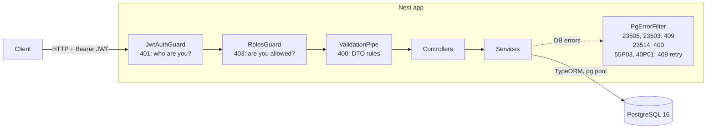
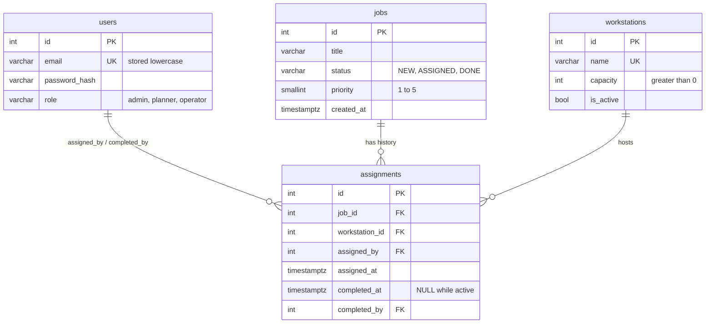

# jobflow-api

[](https://github.com/SrinivasY-Tech/jobflow-api/actions/workflows/ci.yml)

A small, **concurrency-safe job-assignment API**: planners assign Jobs to Workstations, operators
complete them, and a workstation never exceeds its capacity, even under many simultaneous requests.

> **This is a learning project.** I built it to learn PostgreSQL in depth, coming from MySQL and
> MongoDB, using a stack I already know (NestJS, TypeScript). The domain is deliberately generic.
> The measurements and the reasoning behind each decision are in
> [`docs/postgres-notes.md`](docs/postgres-notes.md).
>
> Built with AI assistance (Claude Code) from my own specification. I am reviewing the code and
> reproducing the tests and measurements myself, and I can explain every design decision.

**Stack:** NestJS 11 · TypeScript (strict) · TypeORM 0.3 · PostgreSQL 16 · Docker Compose ·
Jest + supertest · class-validator · Swagger/OpenAPI · JWT with roles · GitHub Actions

---

## What it demonstrates

- **Correctness under concurrency.** Assignment runs in one transaction with `SELECT … FOR UPDATE` row
  locks, plus a **partial unique index** as a database-level backstop. A test fires 50 parallel requests
  at one job and asserts **exactly one 201 and 49 clean 409s**. I also removed each safeguard to show
  what breaks: [results](docs/postgres-notes.md#5-concurrency-what-each-safeguard-prevents-measured).
- **Query tuning with evidence.** 200k seeded jobs, `EXPLAIN (ANALYZE, BUFFERS)` before and after a
  composite index and a partial index. The NEW-queue page went from **1,919 buffers / 12.6 ms to
  23 buffers / 0.14 ms**. The plans are saved in [`docs/explain/`](docs/explain/).
- **Schema owned by migrations.** Hand-written SQL migrations, `synchronize` never enabled,
  `CREATE INDEX CONCURRENTLY`, a drift check, and CI that migrates, reverts and re-migrates an empty database.
- **Auth with roles.** JWT access tokens, scrypt password hashing, and global guards that **fail closed**.

## Architecture





An assignment is **active** while `completed_at IS NULL`. Finished assignments remain as history.

**Docker Compose** runs three services:
- `postgres` (with a healthcheck)
- `migrate`, a one-off job that runs `migration:run` and exits
- `api`, which starts only after `migrate` has **completed successfully**

The Dockerfile is multi-stage: dependencies, then build, then production-only dependencies, then a
small runtime image running as a non-root user.

```
src/
  auth/           JWT login, @Public/@Roles/@CurrentUser, JwtAuthGuard + RolesGuard
  users/          users entity, scrypt PasswordHasher, POST /users, GET /users/me
  workstations/   CRUD + GET /:id/load
  jobs/           create/list/get + POST /:id/assign, /:id/complete
  assignments/    the transactional assign/complete/load logic
  common/         PgErrorFilter (SQLSTATE -> HTTP), ParseIdPipe
  config/         typed env validation (fails fast on boot)
  database/       DataSource config, migrations
  scripts/        create-user (bootstrap admin), seed-jobs (200k rows)
test/             e2e + concurrency suites, test-DB global setup
docs/             postgres-notes.md, explain/ (saved plans + capture script)
```

## Run it

Prerequisites: Docker Desktop. For running outside Docker: Node.js 20.12+ (22 recommended).

```bash
cp .env.example .env
# put a real secret in .env (≥ 32 chars):
node -e "console.log(require('crypto').randomBytes(48).toString('base64url'))"

docker compose up --build -d
docker compose ps -a          # postgres: healthy · migrate: Exited (0) · api: healthy
curl http://localhost:3000/health
# {"status":"ok","checks":{"database":"up"},"uptimeSeconds":5}
```

Create the first admin. The password comes from an environment variable, not a command-line flag,
so it doesn't end up in shell history. Then log in:

```bash
docker compose run --rm -e NEW_USER_PASSWORD='change-me-admin-1' api \
  node dist/scripts/create-user.js --email admin@example.com --role admin

curl -X POST http://localhost:3000/auth/login -H 'Content-Type: application/json' \
  -d '{"email":"admin@example.com","password":"change-me-admin-1"}'
# {"accessToken":"eyJ...","tokenType":"Bearer","expiresIn":900}
```

Create planners and operators with `POST /users` (admin), or with the same script.
**Swagger UI:** http://localhost:3000/docs. Click *Authorize* and paste the token.

**Developing locally** (API on the host, Postgres in Docker):

```bash
npm ci
docker compose up -d postgres
npm run migration:run
npm run start:dev
```

## Tests

| Command | What it runs |
|---|---|
| `npm test` | 53 unit tests (services, guards, hashing, env, pipes). No database needed. |
| `npm run test:e2e` | 17 e2e tests against a real Postgres. Creates `<DB_NAME>_test`, recreates the schema from the real migrations, and **refuses** to run against a database whose name doesn't end in `_test`. Needs `docker compose up -d postgres`. |
| `npm run lint` / `npm run typecheck` | ESLint with type-aware rules / `tsc --noEmit` |
| `npm run migration:check` | Fails if the entities and the migrated schema disagree |

The concurrency suite ([`test/concurrency.e2e-spec.ts`](test/concurrency.e2e-spec.ts)):
- 50 parallel assigns of one job → exactly one `201`, 49 × `409 "Job N is already ASSIGNED"`
- 20 jobs racing for a workstation with capacity 3 → exactly 3 succeed
- 10 parallel completes of one job → exactly one `200`

Each test re-checks the invariant in SQL, not only the HTTP status codes.

**CI** ([`.github/workflows/ci.yml`](.github/workflows/ci.yml)) has three jobs:
- quality: lint, typecheck, build, unit tests
- database (Postgres 16 service): migrate an empty database, drift check, revert and re-apply, e2e tests
- docker: the image builds

**Query tuning:** `npm run seed:jobs -- --count 200000`, then `bash docs/explain/run-explain.sh <label>`.

## API

| Method & path | Role | Notes |
|---|---|---|
| `POST /auth/login` | public | → `{ accessToken, tokenType, expiresIn }`. Same 401 for unknown email and wrong password. |
| `GET /health` | public | `SELECT 1`; 503 if the database is down |
| `POST /users` | admin | Create a user with a role. 409 on duplicate email (case-insensitive). |
| `GET /users/me` | any | The caller's profile |
| `POST /workstations` | admin | `{ name, capacity, isActive? }`. 409 on duplicate name. |
| `GET /workstations`, `GET /workstations/:id` | any | |
| `PATCH /workstations/:id` | admin | 409 if capacity would drop below the current active assignments |
| `DELETE /workstations/:id` | admin | 409 if it has assignment history ("deactivate instead") |
| `GET /workstations/:id/load` | any | Capacity, active count, free slots, active jobs |
| `POST /jobs` | planner | `{ title, priority? }`. Status is always `NEW`. |
| `GET /jobs?status=&minPriority=&page=&limit=` | planner, operator | Ordered by `priority DESC, created_at, id`. Page size ≤ 100. |
| `GET /jobs/:id` | planner, operator | |
| `POST /jobs/:id/assign` | planner | `{ workstationId }` → 201 assignment. 404 if the job or workstation is unknown. 409 if the job is not NEW, or the workstation is inactive or full. |
| `POST /jobs/:id/complete` | operator | 200. 409 if the job is not ASSIGNED. |

Errors use one shape: `{ statusCode, error, message }`. Database errors never leak SQL.

## Design decisions and trade-offs

**Locking: pessimistic row locks in READ COMMITTED.** `assign` locks the **job** row, then the
**workstation** row, counts active assignments, inserts, and updates the status, all in one transaction.
- The job lock makes concurrent assigns of the same job queue up. The second request then re-reads the
  row, sees `ASSIGNED`, and gets a specific 409.
- The workstation lock serializes the capacity check. Capacity is a rule across *many* rows (a count),
  which no constraint can express. Without the lock, transactions see the same count and all insert
  (write skew). Removing it in a test put **10 jobs on a capacity-3 workstation**.
- Locks are always taken in the order job → workstation, so deadlocks can't happen.
- `lock_timeout = 5s` turns a stuck lock into a fast "busy, retry" 409, not an endless wait holding a
  pool connection.
- *Rejected:* `SERIALIZABLE` with retries (correct, but every caller needs retry loops and contention
  causes many aborts), optimistic version columns (they don't cover a rule across many rows), advisory
  locks (invisible in the schema).

**Why a partial unique index:** `UNIQUE (job_id) WHERE completed_at IS NULL`.
- It allows **one active assignment per job but unlimited history**. A plain `UNIQUE (job_id)` would
  forbid ever reassigning a job.
- It's a **backstop that doesn't depend on application code.** With the job lock removed, it still
  limited the result to one active assignment. With both removed, a job ended up with 10.
- The lock gives a good error message; the index guarantees correctness.

**Constraints over pre-checks.** Duplicate names and emails aren't checked with
`SELECT … then INSERT`, which is a race. The `UNIQUE` constraint decides, and `PgErrorFilter` maps
SQLSTATE `23505` to 409. `CHECK` constraints mirror the validation rules, so bad data is rejected
even if it bypasses the API.

**Other choices.**
- `integer` identity keys, not `bigint`, because the `pg` driver returns `bigint` as a string.
- `varchar` + `CHECK` for the status instead of a native `ENUM`, because enum values are hard to change later.
- Entities are listed explicitly instead of found with a glob. On Windows the glob loaded `e:\` and
  `E:\` as two different modules.
- Query logging is off outside development, because TypeORM logged a password hash in a failed query's parameters.
- Global guards with `@Public()` to opt out: forgetting a decorator gives an error, not an open endpoint.
- scrypt from `node:crypto`, so there's no native dependency to compile.
- NestJS 11 and TypeORM 0.3 (CommonJS), not NestJS 12 (ESM-only) or TypeORM 1.x (needs Node ≥ 20.19).

**What I'd change at larger scale.**
- **Capacity counter:** `UPDATE workstations SET active_count = active_count + 1 WHERE id = $1 AND
  active_count < capacity RETURNING …`. One atomic statement instead of lock + count, with
  `CHECK (active_count <= capacity)`. The counter has to be kept consistent with the assignment rows.
- **Pagination:** cursor (keyset) pagination instead of `OFFSET`, and drop the exact `total` (`COUNT`
  is O(n) in Postgres). The notes show that keyset pagination with mixed sort directions needs a
  `UNION ALL` of two index ranges to stay fast.
- **Indexes:** pick one of composite/partial from the real query mix. Both are kept here for comparison;
  [the notes](docs/postgres-notes.md#partial-index-priority-desc-created_at-id-where-status--new-an-honest-result) show they're mostly redundant together.
- **Jobs table:** partition or archive finished jobs; monitor non-HOT updates and autovacuum on `jobs`.
- **Connections:** add PgBouncer in front of Postgres (in transaction mode, `SET LOCAL` still works
  because it's scoped to the transaction). Size the pool against the database's `max_connections`.
- **Auth:** refresh tokens with rotation and a revocation list, and rate limiting on login.

## Known limitations

- Access tokens only: no refresh tokens, no revocation. A changed role or a deactivated user takes
  effect when the token expires (15 minutes by default).
- No rate limiting or lockout on `POST /auth/login`.
- Offset pagination, and an exact `total` that costs a `COUNT` on every list request.
- Operators can complete any assigned job. There's no link between operators and workstations.
- One role per user. No soft delete or archiving of jobs.
- Swagger UI is enabled in every environment.
- `npm audit` reports moderate advisories in TypeORM 0.3's `glob`/`minimatch` dependencies. They only
  match the migration file path from our own config, never user input. Fixing them means TypeORM 1.x,
  which needs Node ≥ 20.19.
- Measurements come from one laptop with Docker Desktop. Compare plans and buffer counts, not the milliseconds.

## License

MIT. See [LICENSE](LICENSE).
